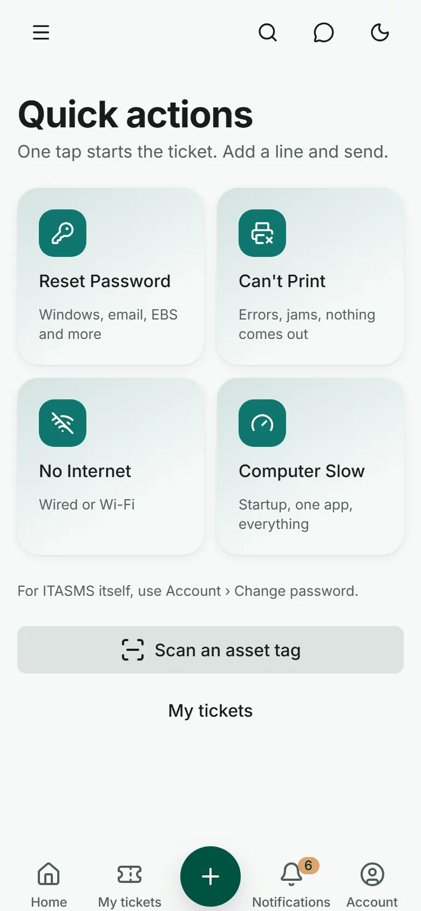
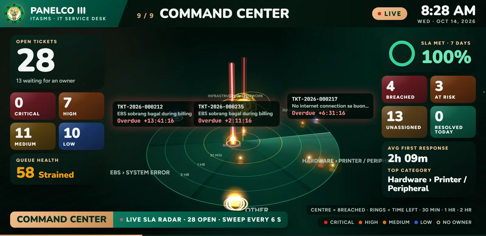
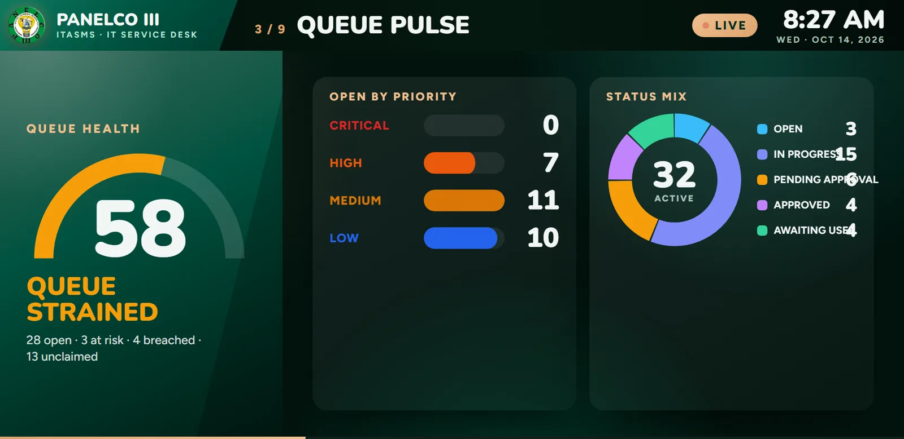
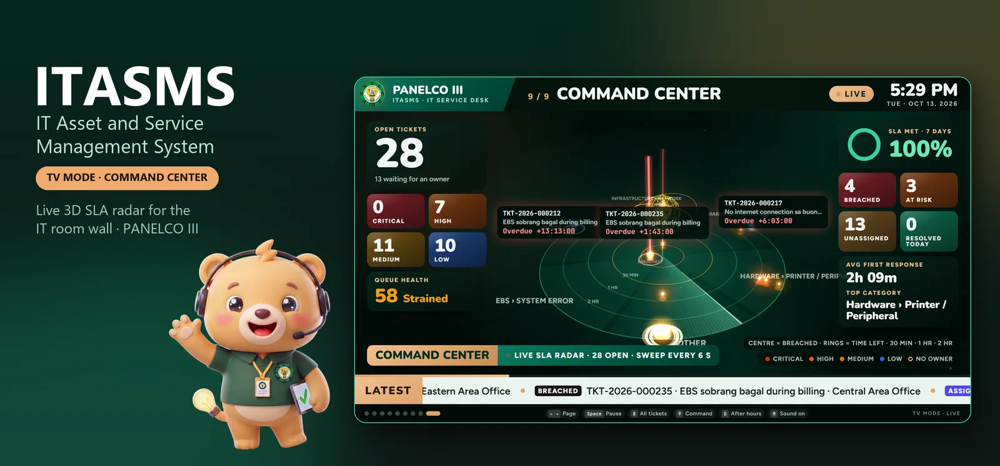
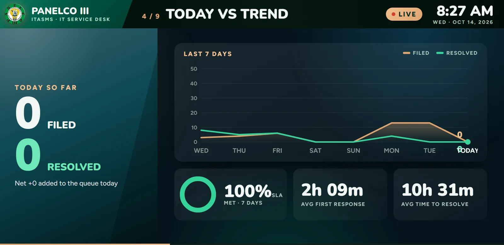
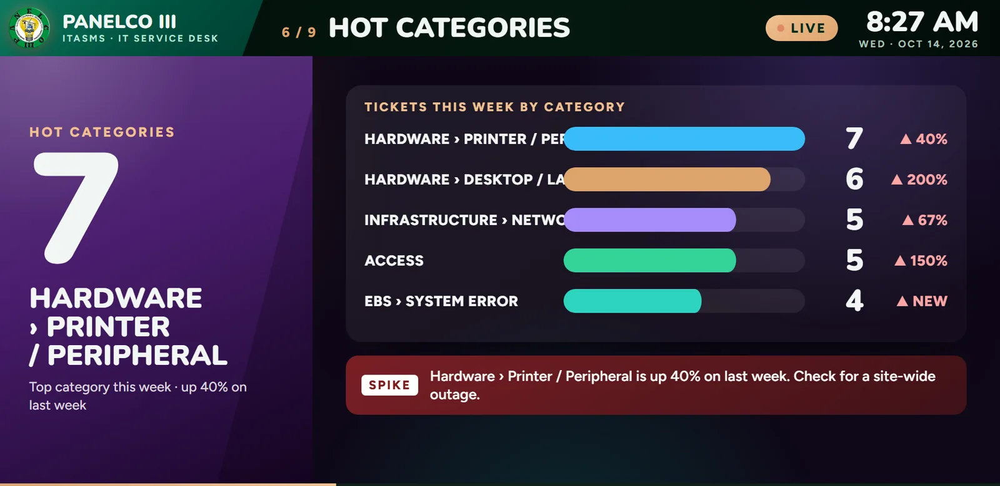

# Enterprise IT Service Management Platform

> One platform replaced phone calls, paper forms, and spreadsheets for about 300 staff across 12 offices.

**Status:** In production · **Client:** Electric cooperative with about 300 employees across 12 offices · **Role:** Solo architect & full-stack engineer

**Stack:** `React 19` `Node.js` `MS SQL Server` `Socket.IO` `Playwright`

> [!NOTE]
> **Showcase repository.** The source code is private and belongs to the client. This repo documents the problem, the architecture, and the results. Screens show demo data. Full case study: https://lesjohnpauloliver.dev/work/enterprise-it-service-management-platform

## Summary

The help desk, asset register, maintenance shop, and IT room wallboard for an electric cooperative, built from scratch to replace phone calls, walk-ins, paper forms, and spreadsheets.

## Scale

- About 300 employees across 12 offices
- 20 modules across service desk, assets and maintenance, and platform
- Load-tested at 300 simultaneous requests with no duplicate ticket or form numbers
- Scale-tested with 100,000 closed tickets in the table
- 1,200+ commits, 38 hand-written SQL migrations, 430+ test files
- 450+ visual baselines in light and dark

## The problem

- IT requests came by phone, walk-in, and paper, and they got lost.
- Nobody could say for sure who held which computer.
- The paper approval chain (supervisor, department manager, general manager) left no trail.

## Problem → fix

### IT requests came by phone, walk-in, and paper, and they got lost.

Every request becomes a numbered ticket in one help desk, with a queue, a kanban board, and per-ticket chat. Employees file from their phone with one tap, or by scanning the QR sticker on a broken device.

Employee mobile app: one-tap tickets for the most common problems, plus asset tag scanning.

### Once a ticket was filed, nothing kept time on it.

A business-hours SLA engine warns at 75%, flags a breach at 100%, and escalates critical and high breaches after 60 business minutes. The IT room TV plots every open ticket on a live 3D SLA radar.

Command center: a live 3D SLA radar plotting every open ticket by time left, with breach and risk counts.

Queue pulse: queue health score, open tickets by priority, and status mix.

### Nobody could say for sure who held which computer.

A QR asset register records custodian, status, location, and condition, with signed custody receipts that print like the official paper forms. A daily digest flags desk workers missing a computer, monitor, or UPS.

The IT help desk, asset register, and TV command center for the IT room.

### The paper approval chain (supervisor, department manager, general manager) left no trail.

Approvals run through a 3-level change chain with one-click email endorsement, HMAC-verified digital signatures, and a full audit log.

### The IT room could not see at a glance which problems were spiking or whether the team was keeping up.

A 9-page TV wallboard rotates through queue health, today against the 7-day trend, team load, and hot categories, built to be read from 3 to 5 metres.

Today vs trend: tickets filed and resolved over 7 days, SLA met, and response and resolution times.

Hot categories: which problem types are spiking this week, flagged before they become an outage.

## Approach

- Crash-safe by design: each write is one short SQL transaction, and emails and notifications go into an outbox in the same transaction, so a crash never loses or duplicates one.
- Every create carries an idempotency key, so a retry after a timeout replays the stored answer instead of filing a second ticket.
- One server with no Redis or message broker; reports run in their own worker so they never slow the help desk.
- Build what gets used: enterprise features that would sit empty for a 300-person cooperative were deliberately left out.

## What was built

- Help desk with a business-hours SLA engine: warning at 75%, breach at 100%, then automatic escalation
- QR asset register with signed custody receipts that print like the official paper forms
- Maintenance shop with repair requests, work orders, and preventive maintenance cycles
- Report Center with 12 reports in 4 formats, on schedules
- Installable mobile PWA and a 9-page TV wallboard for the IT room

## Capabilities

**Help desk**
- Crash-safe ticket filing with 8 statuses and year-based ticket numbers from a SQL sequence
- Category tree and claim rules by priority
- Queue with saved filters and bulk actions, plus a kanban board ordered by SLA risk
- Per-ticket chat with replies, reactions, attachments, unsend, and drafts
- Employees confirm or reject the fix; reminder after 2 days, auto-close after 5
- File a ticket by scanning the QR sticker on a broken device

**SLA engine**
- Business clock from 8am to 5pm on working days, holiday aware
- Pauses while a ticket waits for approval
- Targets by priority, from 1 hour response and 4 hour resolution for critical to 24 hours and 5 days for low
- Warning at 75%, breach at 100%, escalation 60 business minutes after a critical or high breach
- The SLA worker reads only due rows under a 5-minute lease, never the whole ticket table

**Approvals**
- One-click email endorsement
- 3-level change approval chain
- System modification and system access request forms

**Assets and custody**
- Asset register with QR tags, custodian, status, location, and condition
- Memorandum of Receipt, return and transfer slips, and an annual custody register
- Compliance rule: every desk worker holds a computer, monitor, and UPS, with a daily exceptions digest
- Import Center with three Excel templates that round-trip as exports
- My Assets view for employees, with warranty status

**Maintenance**
- Request for Repair from any held device, work orders, and technician slots
- Semi-annual preventive maintenance trips with a checklist and compliance report
- KPIs: MTTR, MTBF, first-time fix, preventive vs reactive, downtime

**Knowledge and engagement**
- "Ask Aytie" help search that suggests articles while an employee is still typing the ticket
- Known issues board with "I'm affected too" and deflection counts
- Quarterly pulse survey with NPS and a CSAT report
- Monthly IT hero badges for top rated, on time, and most thanked technicians

**Reports and insights**
- 12 reports in PDF, Excel, CSV, and Word
- Cron schedules on Manila time, templates, and history
- Signed sign-off page on every major report
- IT operations dashboard with 10+ widgets and an arrival heatmap
- 9 printed forms where every field maps to a database column

**TV command center**
- 9 rotating 1080p pages built to be read from 3 to 5 metres
- Urgent now, Unclaimed, Queue pulse, Today vs trend, Team load, Hot categories, Maintenance, All open tickets
- Command Center: a live 3D SLA radar where breached tickets rise as red beams
- New critical tickets and breaches interrupt with a full-screen bulletin and a chime
- Off-hours mode after 5pm shows critical tickets only; wall TVs pair once with a revocable link

**Mobile**
- Installable PWA with a bottom tab bar and bottom sheets
- One-tap quick actions and a QR asset scanner
- Technicians work the queue from the phone
- Every screen tested at 375 px in light and dark

**Security and admin**
- 8 roles on one resource.action.scope permission map, checked for drift at startup
- Self-registration with an emailed code, lockout, and rate limits
- In-app notifications over Socket.IO with quiet hours and digest mode
- Full audit log and HMAC-verified digital signatures with tamper alerts

## Architecture

- Desktop browsers, the phone PWA, and the IT room TV call one Node, TypeScript, and Express API over HTTPS with JWT.
- Each write commits the row, the outbox entry, and the notice in one SQL Server transaction.
- Background workers handle SLA ticks, the email outbox, reports, and preventive maintenance, each reading leased due rows.
- Socket.IO events carry ids only; clients refetch over REST, so a dropped connection never leaves stale data on screen.
- React 19, Vite, TanStack Query and Table, and Tailwind v4 on the front end; one server under PM2 with nightly retention jobs.

## Engineering

- A kill -9 crash test fires a burst, kills the process, restarts it, and verifies nothing was lost or duplicated.
- Load-tested at 300 simultaneous requests across tickets, queue, custody, maintenance, reports, and surveys.
- A 15,000-ticket report runs in a background worker; in load tests the help desk stays under 500 ms (p95) while three reports generate.
- Query plans are pinned by tests: the report scan must be an index seek or the build fails.
- 15-minute access tokens with 7-day rotated refresh tokens in an HttpOnly cookie, tokens hashed at rest, a CSV formula-injection guard, and a separate read-only login for custom queries.
- Test-driven with Jest against a real SQL Server test database, Vitest and Playwright on the front end, and a quality gate (types, tests, every load test) that must pass before anything merges.

## Where AI does the work

Automation runs the clock: the SLA engine warns, flags breaches, and escalates on its own, and the help center suggests a fix before a ticket is filed.

## Outcome

- Load-tested at 300 simultaneous requests with no duplicate ticket numbers.
- A 15,000-ticket report returns in under 500 ms (p95) in testing, while the help desk keeps running.

---

Built by **[Les John Paul Oliver](https://lesjohnpauloliver.dev)**, AI Engineer in the Philippines: agentic AI, RAG, LLM evals, MCP, and business automation. [Case studies](https://lesjohnpauloliver.dev/#projects) · [Hire me](https://lesjohnpauloliver.dev/ai-engineer-philippines)
